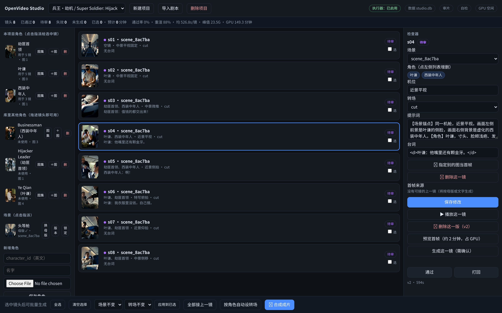
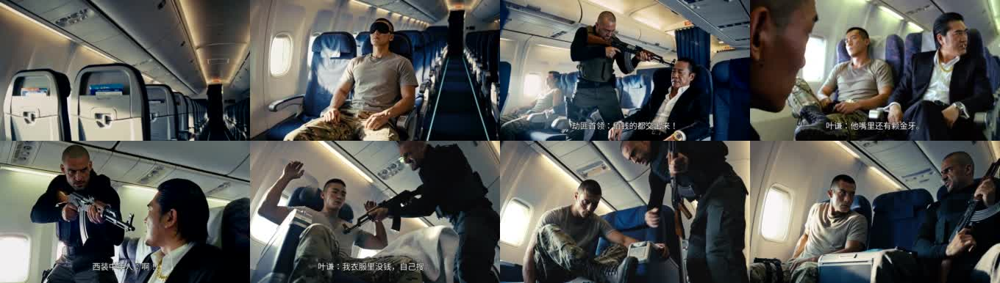
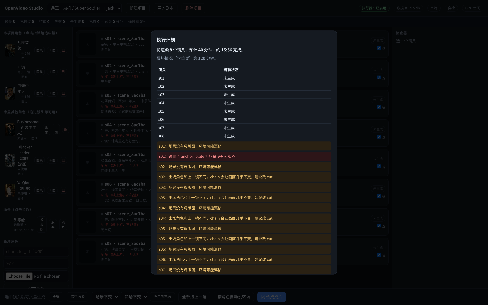
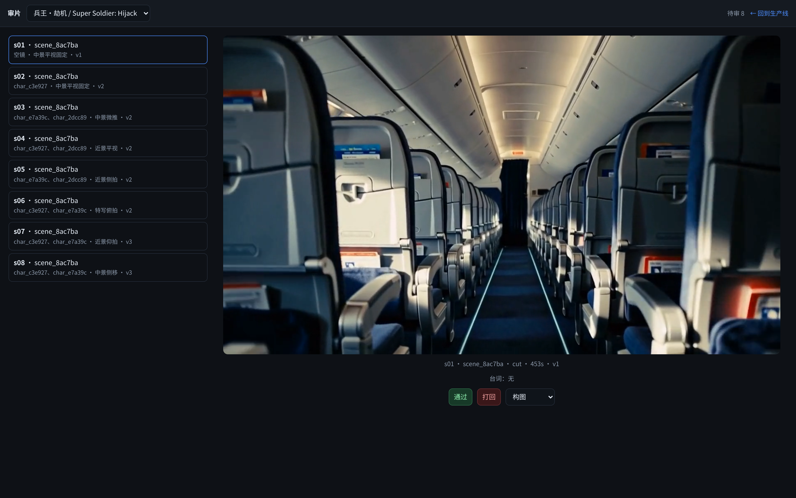
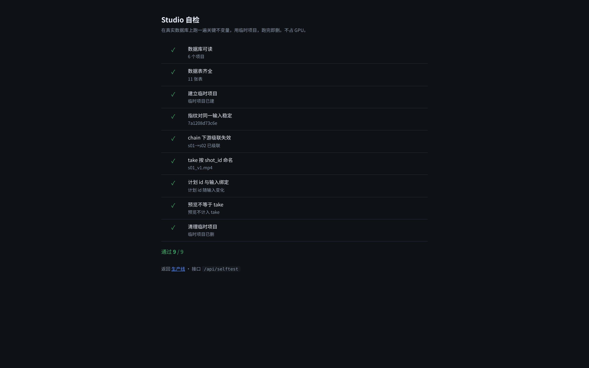

# OpenVideo Studio

**一条可复核的 AI 短剧生产线：角色库 → 剧本 → 分镜 → 逐镜生成 → 审核 → 合成成片。**
跑在你自己的显卡上，不按秒付费，每一步都能追溯。

<p align="center">
  
</p>

<p align="center">
  
  <br>
  <sub>示例成片《兵王·劫机》41 秒 / 8 镜 / 1344×768 / 自动烧字幕</sub>
</p>

> **状态**：0.1.0，**实验性**。它能稳定跑通"剧本→成片"，但出片质量还达不到商用（见 [已知限制](docs/KNOWN-LIMITS.md)）。
> 如果你要的是"点一下就出爆款"，这个项目现在还不是；如果你要的是"可复核、可复现、不烧钱的本地生产线"，它已经是了。
>
> 🎬 **[看成片（8 镜 / 41 秒 / 720p）](https://github.com/v78p5yw922-hue/openvideo-studio/releases/download/v0.1.0/sample-720p.mp4)** ·
> 这张片子就是本项目端到端渲出来的，没有手工剪辑。
>
> **重要前置**：本仓库**不包含模型权重**。README、安装器、文档全都按"你自备 H3 权重"来设计。
> 一个会用的开发者拿到权重后能在 20–30 分钟内装起来；没有权重，装完只能到此为止。
> 逐项判定见 [部署完整性矩阵](docs/DEPLOYMENT-MATRIX.md)。

---

## 界面

| 生产线（角色 / 场景 / 分镜 / 检查器） | 计划确认（先看清单再花钱） |
|---|---|
|  |  |

| 审核页 | 自检（9 项不变量） |
|---|---|
|  |  |

> 计划页会直接列出阻断项和警告，例如"场景没有母版图""出场角色和上一镜不同，chain 会让画面几乎不变，建议改 cut"。

---

## 它解决什么问题

用云端视频模型做短剧，痛点不是"生成不出来"，而是：

| 痛点 | 这里的做法 |
|---|---|
| 同一个角色，每镜长得不一样 | 角色库 + 参考图（最多 4 张/人）+ `H3CastMember` 一致性节点 |
| 改了剧本，不知道哪些镜头要重渲 | **输入指纹**：每个镜头的输入哈希一变，自己变"已失效" |
| 上一镜改了，后面全对不上 | **chain 级联**：上一镜指纹变了，下游自动失效 |
| 一不小心点了生成，半小时没了 | **计划 → 确认** 两段式，先看清单和耗时再执行 |
| 批量渲染中途想停 | 一镜一任务，**可单独停止**，不影响已完成的镜头 |
| 渲完不知道哪条是哪条 | 版本号 + 审核记录 + 成片合成 |

> 关键设计：**镜头身份 = `shot_id`，不是文件路径；输入指纹 = 镜头字段 + 场景 + 角色参考图哈希 + 渲染参数。**
> 所以重渲不会覆盖历史，改名不会丢关联，改一镜能精确算出哪些下游要重跑。

---

## 功能

| 模块 | 能力 |
|---|---|
| **角色库** | 多人参考图（正面/3/4 侧/侧后）、主图切换、删除（被使用时会提示影响范围）、锁定防误改 |
| **场景库** | 空镜母版（作为该场景首镜的锚定帧）、机位/固定物件/光源、版本回滚 |
| **剧本导入** | 一份 Markdown 直接导入：项目卡、世界设定、角色卡、场景卡、镜头表、每镜提示词；导出也回同一格式 |
| **分镜表** | 拖拽排序、批量改转场/锚定、勾选批量生成、按角色自动设转场（换人 → cut） |
| **两段式确认** | `生成计划` 给出镜头数、预计耗时、阻断项；确认后才入队 |
| **队列执行** | 一镜一任务、进度百分比、GPU 峰值、单镜取消、全局停止、OOM 自动释放显存并重试一次 |
| **审核** | 通过 / 打回（带理由）、独立审核页、版本对比 |
| **合成** | 按序拼接 + 自动烧字幕（有台词时），输出 1344×768 MP4 |
| **导出** | EDL（CMX3600）、OTIO、Markdown 往返（导回可继续编辑） |
| **自检** | 9 项不变量自检（`/api/selftest`），每次改动后跑一遍 |
| **备份** | 每日 SQLite `.backup` + rsync 快照，保留 14 份 |

---

## 快速开始

### 前置

- NVIDIA 显卡 **≥ 16 GB 显存**（24 GB 可跑 1344×768 / 20 步；16 GB 建议 896×512）
- Python 3.10+、FFmpeg 5+
- ComfyUI **0.30.0**（安装脚本会拉）
- H3 权重与两个自定义节点：**需你自备**（见 [MODELS.md](docs/MODELS.md)）

### 三种装法

```bash
# A. 你已经有 ComfyUI 和模型 —— 最省事，不下载任何东西
bash install.sh --models-dir /path/to/ComfyUI/models \
                --comfyui-dir /path/to/ComfyUI

# B. 全新机器（只拉代码和 Python 依赖，权重仍需自备）
bash install.sh

# C. 只想先体检，不动任何东西
./ov doctor --models-dir /path/to/models
```

安装器是**幂等**的：跑第二遍不会重装，`--only models` 只处理模型，中断后 `ov install --resume` 继续。
状态记录在 `~/.openvideo/state.json`，每个阶段、每个文件都有独立状态。

```bash
./ov status      # 各阶段状态
./ov models      # 模型清单与命中路径
./ov selftest    # 引擎 + 工作台连通性
./ov start       # systemd（Linux）或前台启动
```

打开 **http://127.0.0.1:8801**。

### 陌生人克隆后能不能跑起来？——已经验证过

不是"看代码觉得可以"，是真的在**另一个目录、另一个 HOME、全新 venv** 里跑了一遍：

| 步骤 | 结果 |
|---|---|
| `git clone` → `/tmp/fresh`（模拟陌生环境） | ✅ |
| `ov doctor`（空 HOME，无状态文件） | ✅ 正确报出缺 GPU/ComfyUI/模型 |
| `ov install --yes --comfyui-dir … --models-dir …` | ✅ 建 venv、装依赖、6 个权重全部按名字+大小命中 |
| 启动打包后的 app（端口 8802、独立数据目录） | ✅ `/api/health` 200 |
| 导入示例剧本 → 计划 → 确认 | ✅ 校验生效（无母版图时计划直接阻断） |
| **真实渲一条 5 秒镜头（草稿 832×480 / 12 步）** | ✅ **108.8 秒**，124 帧，落盘 313 KB |

产物：`examples/` 之外本机留档 `render/fresh_clone_draft.mp4`。

> 仍然**必须人工准备**的只有三样：NVIDIA 驱动、H3 权重、两个自定义节点。这三样是许可/硬件问题，不该由安装器擅自代劳。

### 五分钟跑出一镜

1. 左侧「新增角色」→ 传 1–3 张参考图（正面 + 3/4 侧最有效）
2. 左侧「新增场景」→ 传一张**空镜**当母版
3. 顶部「导入剧本」→ 粘贴 `examples/hijack_8.md`
4. 勾选镜头 → 「生成计划」→ 看耗时 → 「确认执行」
5. 渲完点缩略图审核 → 「🎬 合成成片」

### 用法（三个入口）

| 入口 | 用来做什么 | 文档 |
|---|---|---|
| **网页** `http://127.0.0.1:8801` | 日常生产：传图、导入剧本、排计划、审核、合成 | 本页「五分钟跑出一镜」 |
| **剧本 Markdown** | 写故事 → 导入 → 自动建角色/场景/分镜 | [剧本格式](docs/SCRIPT-FORMAT.md)（含给大模型写剧本的整段提示词） |
| **HTTP / CLI** | 脚本化、Agent 驱动、批量 | [Agent 指南](docs/AGENT-GUIDE.md) |

**剧本是最小上手单位**：一份 Markdown 就能定义项目、角色、场景、8 个镜头和每镜提示词；导出也回同一格式，可往返编辑。

想看实际出片效果：**GitHub Releases** 里的 `sample-720p.mp4`（4.3 MB，8 镜 41 秒）——仓库不存视频，避免克隆变慢。

---

## 架构

```
┌────────────────────────────────────────────────────────────┐
│ 浏览器  http://127.0.0.1:8801                               │
│   生产线：角色/场景/分镜/审核/合成   审核页   自检页          │
└───────────────┬────────────────────────────────────────────┘
                │ HTTP (JSON)
┌───────────────▼────────────────────────────────────────────┐
│ FastAPI + SQLite（studio/）                                 │
│  · 指纹与级联        core/model.py                          │
│  · 业务逻辑/状态机    core/service.py                        │
│  · 剧本解析           core/script_import.py                 │
│  · 两段式确认         /plan → /confirm（plan_id + TTL）      │
│  · 队列执行器         exec/runner.py（原子认领、单任务）      │
└───────────────┬────────────────────────────────────────────┘
                │ subprocess
┌───────────────▼────────────────────────────────────────────┐
│ 渲染层（scripts/）                                           │
│  render_drama.py  → 组工作流 → ComfyUI HTTP API             │
│  render_still.py  → 首帧预览                                │
│  merge.py         → 按序拼接（NVENC）                        │
│  finalize.py      → 烧字幕 / 统一画幅                        │
└───────────────┬────────────────────────────────────────────┘
                │ HTTP :8188
┌───────────────▼────────────────────────────────────────────┐
│ ComfyUI（H3 + H3CastMember + Upsampler）                    │
└────────────────────────────────────────────────────────────┘
```

### 状态机

```
empty ──排队──▶ queued ──▶ running ──▶ review ──通过──▶ passed
  ▲                │            │         │
  │                └──取消───────┘         └──打回──▶ rejected
  └────────────────────────────────────────────────────┘
        输入指纹变化 → stale（历史 take 保留，可对比）
```

### 为什么要有指纹

一次真实的踩坑：把"首帧指定"功能加进指纹后，**所有历史镜头的指纹都变了**，全部误判失效。
教训写进了代码：新增字段只在"确实被使用"时才进哈希（见 `model.shot_fingerprint` 的注释），
这样加功能不会把用户已有的成果判死。

---

## 实测数据（RTX 4090 24 GB）

| 项 | 数值 |
|---|---|
| 单镜 1344×768 / 20 步 / 124 帧 | **432–487 秒**，峰值显存 **22.5–24.1 GB** |
| 草稿 840×480 / 12 步 | 116.5 秒 |
| 每步耗时 | ≈ 20.5 秒 |
| 8 镜 41 秒成片 | 约 68 分钟（含失败重试） |
| 端到端（含审核、合成） | 8 镜约 1.5 小时 |

---

## 已知限制（先看这个再决定用不用）

| 限制 | 说明 |
|---|---|
| **单镜 5 秒** | 模型硬约束。一镜只能一个动作，写两个动作必然只渲首尾 |
| **chain 会锁死画面** | `chain` = 逐像素锁上一镜末帧。**换人 / 大动作必须用 `cut`**，否则整片变成静止长镜头（实测相似度 0.97+） |
| **角色一致性有限** | 参考图 1 张会飘；建议每人 2–3 张，仍不保证百分百 |
| **≤3 角色/镜** | `H3CastMember` 上限 |
| **OOM** | 24 GB 卡在 1344×768 偶尔 OOM；执行器会自动释放显存重试一次 |
| **动作戏** | "枪托砸脸""匕首刺入"这类快速动作基本渲不出来，会退化成对峙 |
| **Windows 原生** | 未支持，当前跑在 WSL2 |
| **单机单卡** | 队列一次只跑一个任务，没有分布式 |

完整清单与实测样本：[docs/KNOWN-LIMITS.md](docs/KNOWN-LIMITS.md)

---

## 给 AI Agent 用

这个项目在设计时就假设"操作者可能是一个 Agent"。命令行与 HTTP 接口都能被脚本驱动，
哪些步骤可以无人值守、哪些必须人来看，写在：

**[docs/AGENT-GUIDE.md](docs/AGENT-GUIDE.md)**

一句话版：

| 可以自动 | 必须人参与 |
|---|---|
| 装依赖、拉 ComfyUI、扫模型、起服务 | 提供模型权重（许可）、确认显存档位 |
| 导入剧本、生成计划、看阻断项 | **确认真实渲染**（花钱和时间） |
| 渲染、轮询进度、失败重试 | 审核画面（好不好看是人的判断） |
| 合成、导出、备份 | — |

---

## 仓库结构

```
openvideo-release/
├─ ov                     # CLI：doctor / install / status / selftest / start
├─ install.sh             # 入口（找到 python3 后交给 ov）
├─ manifest/
│  ├─ components.json     # 钉住的版本（ComfyUI / 节点 / torch / python）
│  └─ models.json         # 权重清单：名字 / 大小 / 必需性 / 作用
├─ app/
│  ├─ studio/             # FastAPI + SQLite + 单页前端（含 27 个测试文件）
│  └─ scripts/            # 渲染管线：组工作流、拼接、烧字幕、校验
├─ services/              # systemd 模板（引擎 / 工作台）
├─ examples/
│  ├─ hijack_8.md         # 可直接导入的示例剧本（8 镜）
│  └─ frames/             # 成片抽帧
└─ docs/
   ├─ INSTALL.md          # 三种装法 + 排错表
   ├─ AGENT-GUIDE.md      # 自动/人工边界
   ├─ ARCHITECTURE.md     # 数据模型、指纹、状态机
   ├─ SCRIPT-FORMAT.md    # 剧本格式 + 让大模型写剧本的提示词
   ├─ MODELS.md           # 每个权重的作用与显存占用
   ├─ DEPLOY.md           # systemd、端口、备份
   ├─ KNOWN-LIMITS.md     # 实测出来的坑
   └─ screenshots/
```

---

## 许可与致谢

代码：**BSD-3-Clause**（见 [LICENSE](LICENSE)）。

第三方（**不随仓库分发**）：ComfyUI（GPL-3.0）、H3 自定义节点与 MiniMax H3 权重（许可由发布方决定）、FFmpeg（LGPL/GPL）。
本仓库不包含任何模型权重，也不代为下载——请从你获得授权的渠道获取。

测试与数据来自一台 RTX 4090 / 64 GB RAM 的 WSL2 环境，所有"秒数"和"显存"都是实测值，不是估算。
