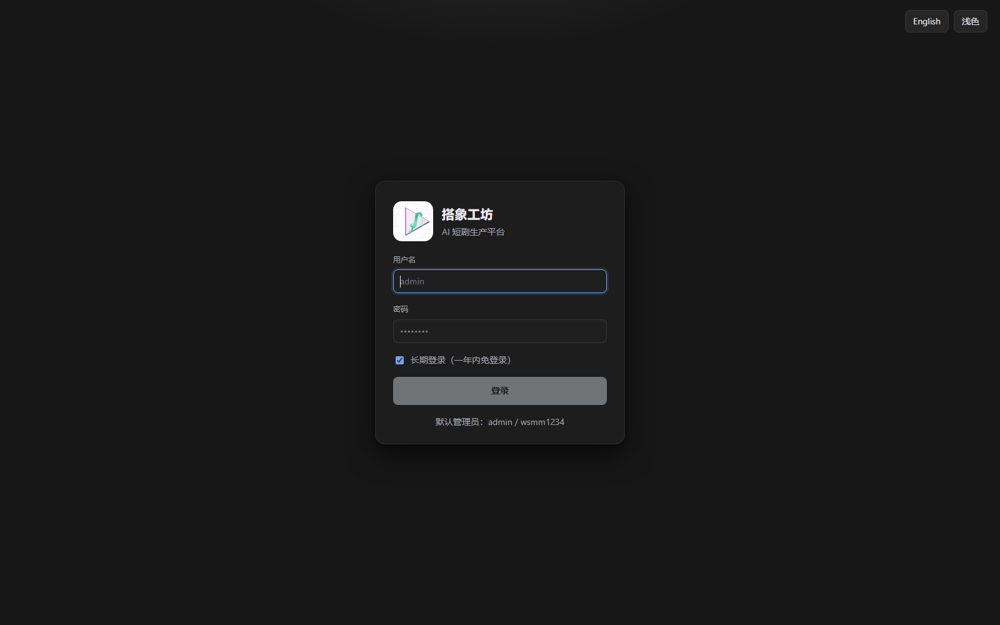
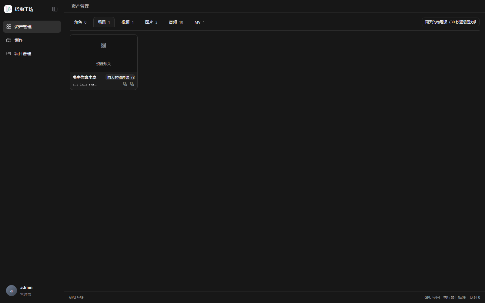
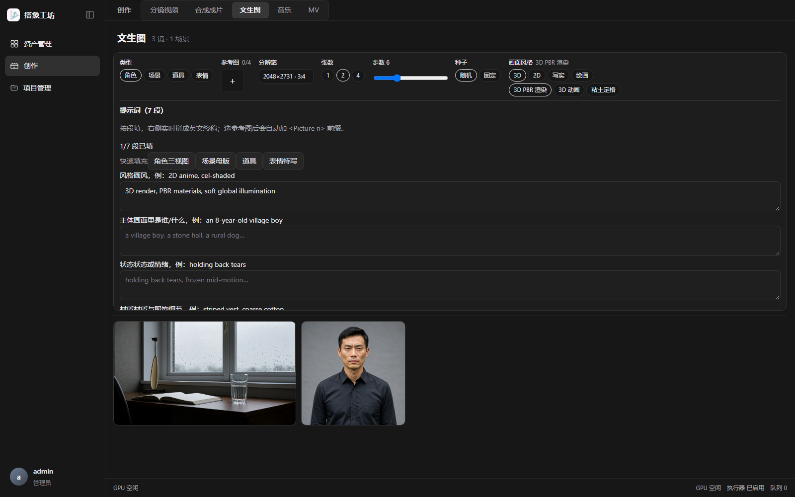
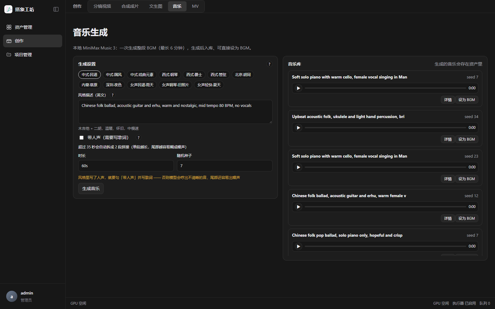
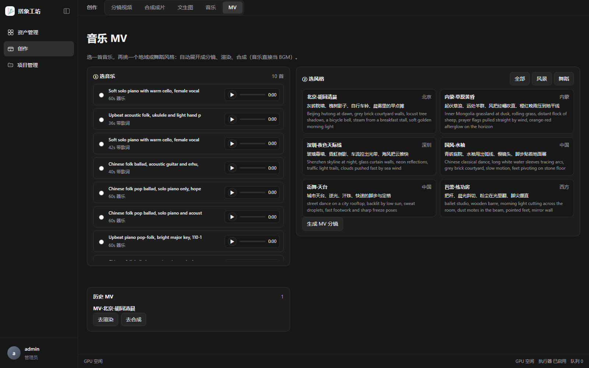

# 搭象工坊

**可自娱自乐的本地 AI 短剧生产线** —— 剧本 → 校验 → 分镜渲染 → 审核 → 合成，
全流程跑在自己的显卡上，不按秒付费，每一步都能复核。

> 0.3 版。界面就是工作台：左边是资产与创作，右边是整条流水线。
> 适合"自己写着玩、顺手做出能发出去的成片"，不承诺商用级质量。



---

## 它解决什么

用 AI 做短剧，难的从来不是"生成一段视频"，而是：

```
同一个角色，每一镜长得不一样
提示词写得像剧本，模型却画成另一回事
改了剧本，不知道哪几镜要重渲
渲完二十镜，拼起来台词和字幕对不上
配乐只会 10 秒循环，铺满 3 分钟就露馅
```

搭象工坊把这四件事变成流程：**角色有定妆照、镜头有契约校验、改稿有指纹追踪、合成有版本记录**，
另外还多两块：**独立的文生图工作台** 和 **能写词能唱的本地音乐生成**。

---

## 界面

### 资产管理：角色 / 场景 / 视频 / 图片 / 音频

顶部分类 tab，每页 30 条；卡片显示所属项目、完整资产 id（可一键复制）、
角色图按原比例缩放，悬浮轻微放大。



### 分镜视频：生产线

镜头卡片 + 契约校验 + 排队渲染。每镜的输入（场景卡、参考图、编译后的提示词、时长）
算一个哈希，改稿后只有受影响的镜头变 `stale`。

### 合成成片

拼接、烧字幕、铺 BGM / 环境声；BGM 可以从音频库里选，也可以指向磁盘上任意音频文件。


### 文生图：独立图片工作台

参数固定在上半屏，下半屏是图片流；按真实比例显示、点开弹窗放大（1× / 1.5× / 2×），
每张图都记录当时的提示词与参数。



### 音乐生成：能写词、能唱

本地 MiniMax Music 3：风格描述 + 歌词 → 整段音乐入库，带 `.lrc` 歌词，
播放器里能看进度和逐句高亮。超过 35 秒自动拆段拼接，避免尾巴糊成噪声。



### 音乐 MV：一首歌 + 一个地域/舞蹈风格

选一首音乐、挑一个风格（北京胡同 / 内蒙草原 / 深圳夜色 / 国风水袖 / 街舞 / 芭蕾），
自动展开成分镜项目：整片只用这一首歌铺底、镜头末帧接续、空间锚点固定。



### 项目管理


---

## 三条命令跑起来

```bash
# 1. 依赖（Python 3.10+，需要 ffmpeg）
python3 -m venv .venv && . .venv/bin/activate
pip install -r app/requirements.txt

# 2. 配置（引擎地址、模型目录、数据目录）
cp config.example.toml config.toml && $EDITOR config.toml

# 3. 体检 + 启动
bash install.sh      # 7 项体检：配置/引擎/节点/权重/ffmpeg/数据目录/GPU
./ov up              # 打开 http://127.0.0.1:8801
```

默认账号：`admin / wsmm1234`（首次启动自动创建，登录后请改密码）。

---

## 不会写剧本也能用

```
设置 → 写作技能
  ① 选「写剧本（drama-write）」
  ② 填剧集和剧情（大白话就行）
  ③ 复制提示词 → 粘到任意大模型
  ④ 把返回的分镜粘回来 → 点「校验」
```

写完了想挑毛病，选「审剧本（drama-review）」，按 7 项评审表挑问题，
每条必须给原文证据 + 可替换的改法。

---

## 流水线

```
剧本 Markdown ──导入──► 项目/场景/角色/镜头（SQLite）
                          │
                          ├─ 契约校验（60+ 条规则 → 55 个校验码）
                          ├─ 提示词编译（中文七槽 → 模型原生语法）
                          ├─ 队列渲染（单卡串行，逐镜入库）
                          ├─ 审核（pass / reject + 原因，多版本可选）
                          └─ 合成（拼接 + 字幕 + 音轨）
```

---

## 硬性约束（实测，写进代码的常量）

| 项 | 值 |
|---|---|
| 分辨率 | 1344×768（横屏） |
| 时长 | 5 / 8 / 10 秒（帧数 124 / 192 / 243，满足 `17k+5`） |
| 步数 | 视频 20 步；文生图 6 步；音乐 30 步 |
| 耗时 | 5s ≈ 9 分钟 · 8s ≈ 17 分钟 · 10s ≈ 27 分钟（RTX 4090 / 24 GB） |
| 显存 | 视频 16–23.5 GB；音乐约 12–15 GB（按需加载，不常驻） |
| 参考槽 | 9 张（人物 + 场景共享） |
| 音乐 | 单段 ≤ 35 秒最稳；更长自动拆段交叉淡化（上限 360 秒） |

模型：MiniMax H3 系列（视频 fl2va / ref2va、图像 image）+ Qwen3-VL 文本编码器
+ MiniMax Music 3（int8）；节点依赖 ComfyUI ≥ 0.45.3 与 comfy-kitchen 0.2.41。
详见 [docs/MODELS.md](docs/MODELS.md)。

---

## 已经踩过的坑（都写进校验器了）

```
成年人和孩子同框 → 中全必切掉大人的头：改全景 + 4 米 + headroom
人物背对目标却指着目标 → 方向矛盾：机位放身后，回头才是真回头
说话人不在画内 / 占比太小 → 台词会被判给画内唯一有脸的人
商店场景没写招牌 → 渲出来像民宅：门脸 + 红底金字横幅招牌
单镜超过 35 秒 → 模型尾部糊成噪声：分段生成 + 交叉淡化
风格里写了人声却没给歌词 → 哼出不清晰的音 + 尾部噪声
```

细节见 [docs/REVIEW-LESSONS.md](docs/REVIEW-LESSONS.md)（14 条）。

---

## 文档

- [安装](docs/INSTALL.md) · [部署](docs/DEPLOY.md) · [模型](docs/MODELS.md) · [已知限制](docs/KNOWN-LIMITS.md)
- [项目总览（技术 + 产品）](docs/PROJECT-SUMMARY.md)
- [写剧本规则](docs/RULES-STRICT.md) · [分镜格式 V3](docs/SCRIPT-FORMAT-V3.md) · [镜头怎么选](docs/SHOT-SELECTION.md)
- [历史打回 14 条](docs/REVIEW-LESSONS.md) · [开源化评估](docs/PLAN-OPENSOURCE.md)

---

## 许可

代码 MIT；模型权重与 ComfyUI 各自的许可见 [docs/MODELS.md](docs/MODELS.md)，**不随本仓库分发**。

> AI 生成内容请按所在平台要求标注（国内平台自 2025-09 起为强制）。
